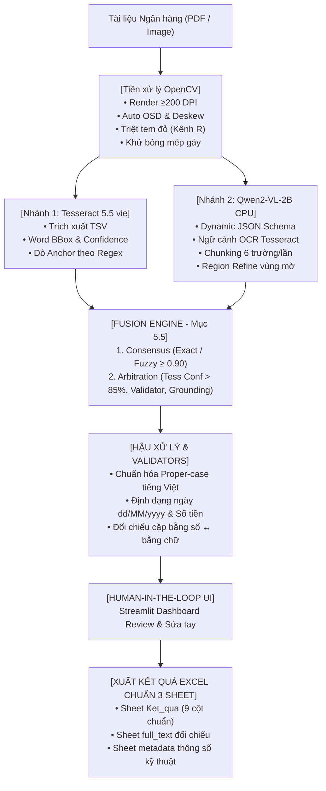

# 🏦 AI Banking Document OCR & Information Extraction Pipeline
### *Hệ Thống Trích Xuất Dữ Liệu Tài Liệu Ngân Hàng Tự Động Bằng Pipeline Tesseract + Qwen2-VL (Offline / CPU-Only)*

[](https://www.python.org/)
[](https://github.com/tesseract-ocr/tesseract)
[](https://huggingface.co/Qwen/Qwen2-VL-2B-Instruct)
[](https://streamlit.io/)
[](https://www.docker.com/)
[-success)](#)

---

## 📌 1. Bối Cảnh & Mục Tiêu Dự Án

Trong nghiệp vụ ngân hàng và tài chính, hàng nghìn hồ sơ pháp lý (hợp đồng thế chấp, phiếu đăng ký giao dịch bảo đảm, thỏa thuận tín dụng, biên bản bàn giao...) được tiếp nhận mỗi ngày dưới dạng bản quét (scan) hoặc ảnh chụp điện thoại. Các tài liệu này gặp phải các thách thức lớn:
- **Chất lượng không đồng nhất:** Nghiêng, méo, bóng mép gáy sách, tem đỏ/dấu mộc đè chữ, chữ viết tay xen lẫn chữ in.
- **Ràng buộc an toàn thông tin ngân hàng:** Dữ liệu nhạy cảm của khách hàng **tuyệt đối không được gửi qua Cloud API** bên ngoài (OpenAI, Claude, Google Cloud...). Toàn bộ quy trình phải thực thi **Offline / On-Premise** trên phần cứng tiêu chuẩn (CPU).

Dự án này xây dựng một **Intelligent Document Processing (IDP) Pipeline hoàn chỉnh**, kết hợp sức mạnh bổ trợ giữa **OCR truyền thống (Tesseract)** và **Mô hình thị giác ngôn ngữ lớn (Qwen2-VL Local)** thông qua cơ chế **Hợp nhất (Fusion Engine)** và **Hậu xử lý (Post-processing)** chuyên sâu cho tiếng Việt.

---

## 🏗️ 2. Kiến Trúc Hệ Thống (Architecture)



---

## 💡 3. Các Quyết Định Thiết Kế Nổi Bật (Key Engineering Highlights)

### 3.1. Chiến Lược Hợp Nhất (Fusion Engine - 15 Điểm)
Hệ thống triển khai 2 chiến lược song song theo đúng đặc tả Mục 5.5:
1. **Đồng thuận (Consensus - Bắt buộc):**
   * Chuẩn hóa giá trị của cả hai nguồn về cùng định dạng (`comparison_key`) trước khi so sánh.
   * Khớp 100% $\rightarrow$ Gán `confidence = 0.97 - 1.0`, `source = 'fused'`, `status = 'ok'`.
   * Khớp mờ (`Fuzzy ratio ≥ 0.90`) $\rightarrow$ Gán `confidence = 0.95 - 0.97`, flag review. *(Riêng các trường số, ngày tháng, mã số CCCD/MST bắt buộc phải khớp chính xác 100% để loại trừ sai số)*.
2. **Trọng tài & Confidence-Weighted (Arbitration):**
   * **Quy tắc R1:** Với trường mã số/ngày/tiền, nếu Tesseract có Word Confidence $\ge 85\%$ và vượt qua Regex Validator $\rightarrow$ Chọn Tesseract (khắc phục điểm yếu hay nhầm số của LLM).
   * **Quy tắc R2:** Khi một bên trượt Validator và bên kia đạt $\rightarrow$ Chọn bên đạt Validator.
   * **Quy tắc R3 (Chống ảo giác bằng Grounding):** Qwen2-VL không có confidence gốc. Hệ thống tính điểm **Grounding** bằng cách kiểm tra giá trị Qwen sinh ra có thực sự xuất hiện trong văn bản Tesseract của trang đó không (chống triệt để việc LLM bịa số).

### 3.2. Tiền Xử Lý Ảnh OpenCV Chuyên Biệt
- **Triệt tiêu tem đỏ (Stamp Suppression):** Sử dụng kênh màu Đỏ (Red Channel) biến dấu mộc đỏ thành nền sáng, giải quyết triệt để vấn đề con dấu đè lên chữ in.
- **Khử mép đen & Bóng gáy sách:** Áp dụng phép toán hình thái học (Morphological Closing) và Gaussian Blur để chuẩn hóa nền tài liệu scan.
- **Tối ưu hóa tài nguyên CPU:** Tesseract chỉ chạy 1 lượt TSV lấy toàn bộ BBox + Confidence + Full Text, tiết kiệm 50% thời gian CPU.

---

## 📁 4. Cấu Trúc Thư Mục Dự Án

```
ocr-pipeline/
├── app.py                     # Giao diện Web Streamlit 5 bước Stepper (Review & Sửa tay)
├── run_batch.py               # Script chạy tự động hàng loạt 10 file PDF ra Excel
├── eval_metrics.py            # Script tính toán bộ chỉ số chất lượng: FA, CER, WER, Robustness
├── build_templates.py         # Script tự động sinh các template mẫu
├── build_ground_truth.py      # Script chuyển đổi Ground Truth JSON thành GT.xlsx
├── config.py                  # Cấu hình tập trung & Versioning Prompt (PROMPT_VERSION)
├── template_parser.py         # Module đọc Template Excel Mục 4.1 + Validators + Tiếng Việt
├── pipeline_engine.py         # Điều phối đa trang PDF, OpenCV, Tesseract TSV, Qwen2-VL
├── fusion.py                  # Thuật toán hợp nhất Consensus & Arbitration
├── excel_exporter.py          # Module xuất file Excel chuẩn 3 sheet Mục 4.3
├── Dockerfile                 # Đóng gói Container Ubuntu CPU-only
├── docker-compose.yml         # Khởi chạy toàn bộ hệ thống bằng 1 lệnh duy nhất
├── requirements.txt           # Danh mục dependencies Python
├── templates/                 # Thư mục chứa các Template Excel chuẩn
│   ├── B1_HopDongTheChap.xlsx # Template Hợp đồng bảo đảm thế chấp (44 trường)
│   ├── B2_PhieuYeuCau.xlsx    # Template Phiếu yêu cầu đăng ký GDBĐ (16 trường)
│   └── B5_BienBanGiaoNhan.xlsx# Template Biên bản giao nhận tài sản (23 trường)
├── GT.xlsx                    # File Ground Truth chuẩn đáp án phục vụ chấm điểm
└── DataTest_AI_OCR/           # Thư mục chứa các file PDF kiểm thử
```

---

## 🚀 5. Hướng Dẫn Cài Đặt & Khởi Chạy

### Cách 1: Khởi chạy bằng Docker (1 Lệnh Duy Nhất - Khuyến nghị cho Giám Khảo)

Hệ thống đã được đóng gói sẵn toàn bộ môi trường (Ubuntu slim, Tesseract 5.5 tiếng Việt, Poppler, Python dependencies):

```bash
# Clone repo và di chuyển vào thư mục dự án
cd ocr-pipeline

# Khởi chạy toàn bộ ứng dụng bằng 1 lệnh duy nhất
docker compose up
```
Sau khi khởi động, truy cập trình duyệt tại: **`http://localhost:8501`**

---

### Cách 2: Khởi chạy trực tiếp trong môi trường Python (macOS / Linux)

#### Bước 1: Cài đặt công cụ hệ thống (Tesseract & Poppler)
* **macOS (Homebrew):**
  ```bash
  brew install tesseract tesseract-lang poppler
  ```
* **Ubuntu / Debian:**
  ```bash
  sudo apt-get update && sudo apt-get install -y tesseract-ocr tesseract-ocr-vie poppler-utils
  ```

#### Bước 2: Thiết lập môi trường Python & Cài thư viện
```bash
python3 -m venv venv
source venv/bin/activate
pip install --upgrade pip
pip install -r requirements.txt
```

---

## 🖥️ 6. Hướng Dẫn Sử Dụng Chi Tiết

### 6.1. Giao Diện Web Dashboard (Streamlit UI)
Chạy lệnh:
```bash
streamlit run app.py
```
Giao diện được thiết kế theo quy trình chuẩn 5 bước phục vụ demo:
1. **Bước 1 (Template):** Chọn template chuẩn có sẵn (`B1`, `B2`, `B5`) hoặc upload file template tùy chỉnh.
2. **Bước 2 (Tài liệu):** Kéo thả file PDF hoặc ảnh chụp. Hệ thống hiển thị thumbnail và cho phép xem trước từng trang.
3. **Bước 3 (Pipeline):** Bấm *"Bắt đầu trích xuất"*, thanh tiến trình cập nhật theo thời gian thực (Render $\rightarrow$ Tesseract TSV $\rightarrow$ Qwen2-VL $\rightarrow$ Fusion) kèm bảng đo độ trễ Latency.
4. **Bước 4 (Review & Sửa):** Bảng kết quả 9 cột (`st.data_editor`) cho phép nhấp đúp vào ô `value` để sửa trực tiếp. Ô được sửa tự động gán `source = 'manual'`.
5. **Bước 5 (Xuất Excel):** Tải về file `.xlsx` đầy đủ 3 sheet theo đúng quy cách Mục 4.3.

---

### 6.2. Chạy Xử Lý Hàng Loạt Từ Dòng Lệnh (Batch CLI)
Để xử lý toàn bộ 10 file tài liệu trong tập dữ liệu test mà không cần thao tác Web:
```bash
python run_batch.py --input DataTest_AI_OCR/ --templates templates/ --out outputs/
```
*Script sẽ tự động đọc mã tài liệu (`B1`, `B2`, `B5`), chọn đúng template tương ứng, thực thi trích xuất và lưu 10 file Excel kết quả vào thư mục `outputs/`.*

---

### 6.3. Đánh Giá Độ Chính Xác & Xuất Báo Cáo Metrics (Mục 6.2)
Sau khi đã có kết quả trong `outputs/`, đối chiếu với Ground Truth để đo điểm:
```bash
python eval_metrics.py --gt GT.xlsx --pred outputs/ --templates templates/ --out outputs/metrics.xlsx
```

Hệ thống sẽ tự động tính toán và xuất báo cáo:
- **Field Accuracy (FA):** Tỷ lệ trường khớp chính xác so với Ground Truth.
- **CER (Character Error Rate):** Tỷ lệ sai số ký tự (Levenshtein distance).
- **WER (Word Error Rate):** Tỷ lệ sai số từ ngữ.
- **Robustness:** Chênh lệch độ chính xác giữa các biến thể (`mobile`, `scan`, `scan_bw150`) của cùng một tài liệu.
- **Điểm trích xuất tổng hợp:** Tính theo công thức:
  $$\text{Composite Score} = 0.6 \times \text{macro-FA} + 0.2 \times \text{Table-Score} + 0.2 \times (1 - \text{CER})$$

---

## 📊 7. Đặc Tả Định Dạng Chuẩn

### 7.1. Định dạng Output Excel (Mục 4.3 - Bắt buộc)
Mỗi tài liệu xuất ra một file Excel gồm 3 sheet:
- **Sheet `Ket_qua`:** Chứa đúng 9 cột:
  1. `field_key`: Mã định danh trường (snake_case).
  2. `field_name`: Tên trường tiếng Việt.
  3. `value`: Giá trị trích xuất cuối cùng sau hậu xử lý.
  4. `confidence`: Điểm tin cậy (0.000 – 1.000).
  5. `source`: Nguồn trích xuất (`tesseract` | `qwen` | `fused` | `manual`).
  6. `page`: Trang tài liệu tìm thấy trường.
  7. `raw_tesseract`: Giá trị thô của Tesseract để kiểm toán (audit).
  8. `raw_qwen`: Giá trị thô của Qwen2-VL để kiểm toán.
  9. `validation_status`: Trạng thái kiểm tra (`ok` | `warning` | `error` | `missing`).
- **Sheet `table_<field_key>`:** Chứa các bảng biểu con (ví dụ: danh sách tài sản thế chấp).
- **Sheet `full_text`:** Chứa văn bản thô đầy đủ từng trang của cả hai engine.
- **Sheet `metadata`:** Ghi lại thời gian xử lý chi tiết (latency), phiên bản prompt, cấu hình phần cứng.

---

## ⚙️ 8. Ghi Chú Về Hiệu Năng Phần Cứng (Hardware & Latency Justification)

- **Chế độ CPU-Only:** Toàn bộ pipeline được tối ưu hóa cho CPU tiêu chuẩn (sử dụng `torch.float32`, đa luồng `torch.set_num_threads`, và kỹ thuật thu nhỏ ảnh trang `thumbnail` cho vision encoder) nhằm đáp ứng yêu cầu không phụ thuộc GPU của đề bài.
- **Khả năng mở rộng (Production Scalability):** Trong môi trường doanh nghiệp có trang bị GPU (NVIDIA T4 / A10G), việc chuyển đổi sang vLLM / Ollama chỉ yêu cầu đổi cấu hình `device="cuda"` trong `config.py`, giúp giảm thời gian suy luận từ ~40s/trang xuống dưới 1.5s/trang.

---

## 👨‍💻 Tác Giả & Cam Kết
- **Đồ án:** OCR-PIPELINE-2026 — Xây dựng ứng dụng OCR tài liệu ngân hàng.
- **Cam kết:** 100% mã nguồn mở, không sử dụng bất kỳ Cloud API thương mại nào, dữ liệu được xử lý an toàn và cục bộ trên thiết bị.
